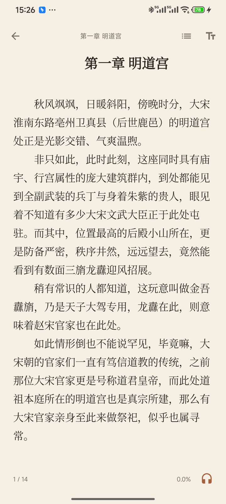
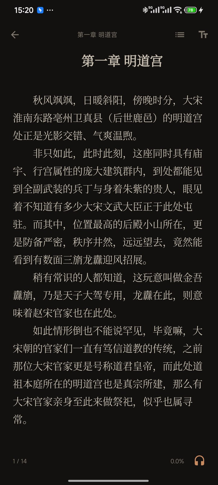
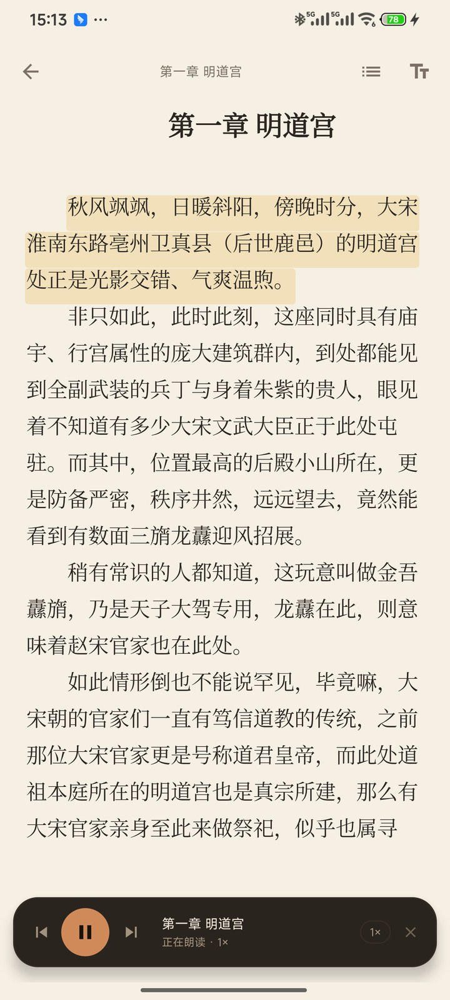
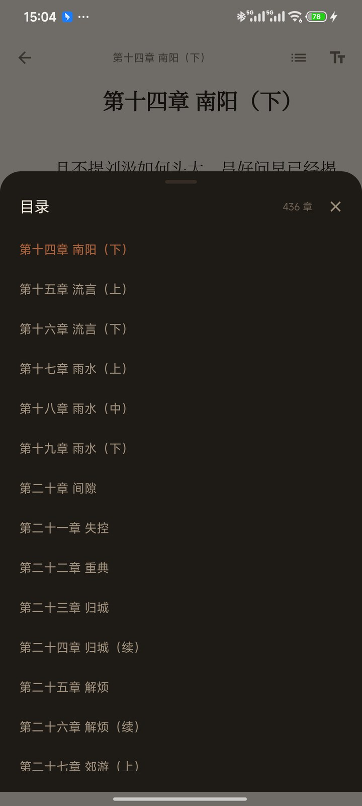
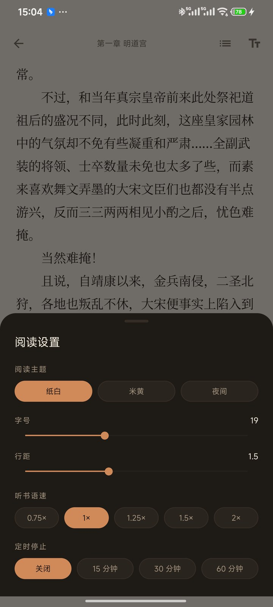

# 墨听 · MOBI 阅读与听书

一个不依赖第三方 UI 库的 Android 电子书应用，专注两件事：**读 MOBI** 与 **听 MOBI**。

- 包名：`com.chennan.moting`
- 最低系统：Android 8.0（API 26）
- 编译目标：Android 14（API 34）
- 安装包：`dist/MoTing-1.0.0.apk`（release，已签名；使用仓库内证书，供本地安装）

| 书架 | 阅读（纸白） | 阅读（夜间） |
| --- | --- | --- |
|  |  |  |

| 听书 | 目录 | 阅读设置 |
| --- | --- | --- |
|  |  |  |

## 功能

### 书架
- 导入本地 `.mobi` 文件（系统文件选择器 / 文件管理器「打开方式」）
- 解析封面、书名、作者、目录与章节数
- 继续阅读卡片、阅读进度、长按或菜单删除、书籍信息
- 导入完成后可直接开始阅读

### 阅读
- 自研分页引擎：按屏幕尺寸真实分页，点击左右或滑动翻页；章末/章首继续翻页自动跨章（带滑动过渡）
- 三种主题：纸白、米黄、夜间
- 字号（14–28sp）与行距（1.2–2.0）可调，实时重排
- 目录跳转、页内页码、全书百分比
- 中文段落自动缩进、保留粗体/斜体、居中章节标题
- 阅读位置（章节 + 字符偏移）自动保存与恢复

### 听书
- 基于系统 TTS 逐段朗读，段落高亮跟随（引擎支持时精确到字）
- 自动翻页、自动进入下一章
- 播放/暂停、上一段/下一段、0.75×–2.0× 语速
- 定时停止（15 / 30 / 60 分钟）
- 前台服务、通知栏播放控制、锁屏 / 蓝牙媒体按键、熄屏继续朗读

## 构建

环境要求：JDK 17+（本机实测 JDK 24 可用）、Android SDK（platform 34 + build-tools 34/35）。

```bash
./build.sh                 # 默认 assembleDebug
./build.sh assembleRelease # 构建 release
```

产物：

- `app/build/outputs/apk/release/app-release.apk`
- `app/build/outputs/apk/debug/app-debug.apk`

安装：

```bash
adb install -r dist/MoTing-1.0.0.apk
```

运行单元测试（解析器 / HTML 转换）：

```bash
./gradlew :app:testDebugUnitTest
# 可用 MOTING_TEST_MOBI=/path/to/real.mobi 指定真实书籍做集成验证
```

## 技术实现

```
app/src/main/java/com/chennan/moting/
├── mobi/                 # 纯 Kotlin MOBI 解析（可在 JVM 单测）
│   ├── PalmDb.kt         # PalmDB 记录表
│   ├── MobiHeader.kt     # PalmDOC/MOBI 头、EXTH 元数据、DRM/KF8 检测
│   ├── Decompressors.kt  # PalmDOC LZ77、HUFF/CDIC、记录尾部数据裁剪
│   ├── IndexParser.kt    # INDX/TAGX/CTOC，读取 NCX 目录
│   └── MobiBook.kt       # 章节切分、封面提取、按需解码
├── text/HtmlToText.kt    # MOBI HTML → 阅读文本模型（段落、样式、缩进）
├── data/                 # 书架 JSON、导入、阅读偏好
├── ui/                   # 书架、阅读器、分页控件、配色
└── tts/                  # TTS 控制器 + 前台服务 / MediaSession
```

要点：

- 解析器不依赖 Android API；真实 15 MB / 436 章中文 MOBI 解析约 1 秒。
- 正文解压后保留字节流，章节按需解码，避免一次性生成全部字符串。
- 分页用 `StaticLayout` 对整章排版后按行高切页；绘制时整体位移，翻页不重排文字，并按“本页最后一行”精确裁剪。
- TTS 按段落切片（超长段落按标点二次切分），`onRangeStart` 可用时逐字高亮，否则整段高亮。
- Android 11+ 必须在清单中声明 `TTS_SERVICE` 查询，否则 `TextToSpeech` 无法发现系统引擎。

## 已验证

在 Redmi 23013RK75C（Android 15 / HyperOS）实机验证：

- 导入 15 MB、436 章的《绍宋》MOBI，书名/作者/封面/目录解析正确
- 分页、页码、章节恢复、纸白/夜间主题、字号与行距设置
- 手动翻页跨章：末页继续翻进入下一章，首页反向翻回到上一章末页
- 目录定位到当前章、设置面板实时生效
- 听书：小米语音引擎初始化、朗读、段落高亮、自动翻页、自动进入下一章、2 倍速、媒体通知与会话状态
- 导入《凡人修仙传》（20 MB / 2464 章）：NCX 只有卷级目录时自动改用分页符切章，顺序与标题正确
- 非 MOBI 文件会给出明确错误提示

## 调试入口（可选）

`LibraryActivity` 支持隐藏的 adb 参数，便于无触摸自动化验证：

```bash
adb shell am start -n com.chennan.moting/.ui.LibraryActivity \
  --es open_book_id <bookId> --ei chapter 1 --ei char 0 \
  --ez listen true --ez wake true
```

支持 `chapter`、`char`、`listen`、`show_toc`、`show_settings`、`auto_turn`、`wake`、`skip_permission`。正常使用不会触发。

## 已知限制

- 仅支持经典 MOBI（Mobipocket，mobiType=2）；**AZW3 / KF8-only 会提示不支持**。双格式文件读取其中的 MOBI7 部分。
- 带 DRM 的书籍无法解析（会明确提示）。
- 暂不显示书内插图（封面正常）。
- 听书依赖设备已安装的中文 TTS 引擎；部分精简系统需要先安装语音包。
- 未做平板双栏排版。

## 许可

仅用于个人学习与自用。
